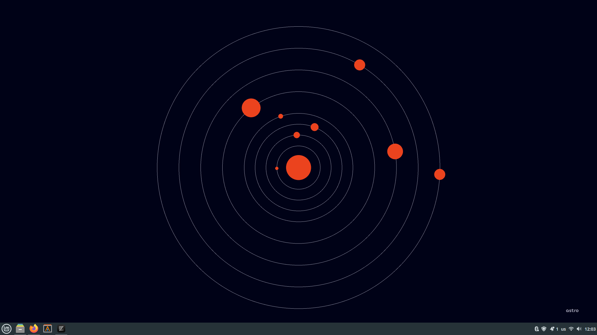
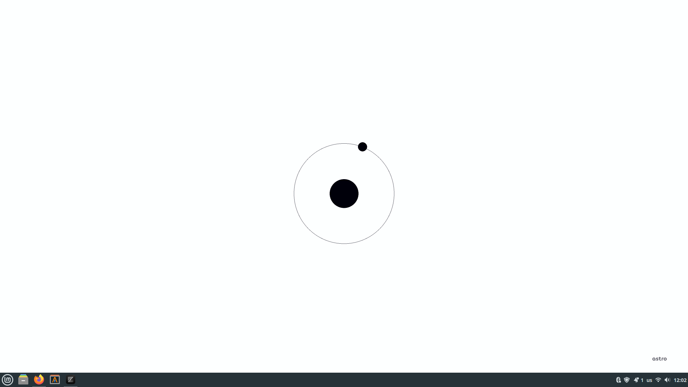
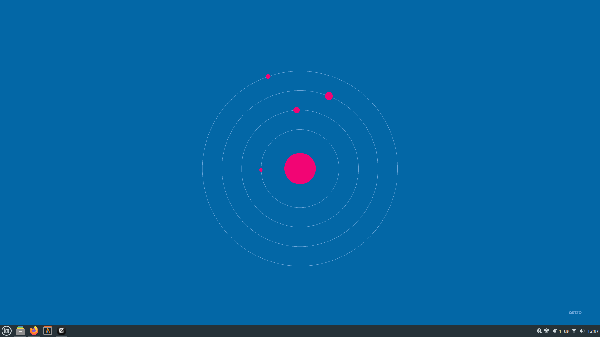

## INSTALLATION INSTRUCTIONS

#### FOR LINUX AND MAC

Run the file **linux_mac_run.sh** and set the background of your pc to **img.png** (img.png should be in the output directory, if it isn't there try running **main.py**. If it still doesn't work you can contact me at *malpollus@gmail.com*)
To make the background update, set the **linux_mac_run.sh** file to run at pc startup using your disto's tools.

#### FOR WINDOWS

Run the file **windows_run.bat** and set the background of your pc to **img.png** (img.png should be in the output directory, if it isn't there try running **main.py**. If it still doesn't work you can contact me at *malpollus@gmail.com*)
To make the background update, set the **windows_run.bat** file to run at pc startup using windows tools.
The **windows_run.bat** file should be able to run in both windows 10 and 11.

## CUSTOMIZATION

The customization of the background is done inside the **main.py** code.
To change colors and resolution just play around with the constants that I put at the beginning of the code.
To change the planets size you have to play around with the third parameter of the **Planet** constructor (*radius*).
If you want to remove some planets just comment out the **planet.drawPlanet()** line (e.g comment out: *#mars.drawPlanet()*)

You can change the code at your will.

## EXAMPLES

